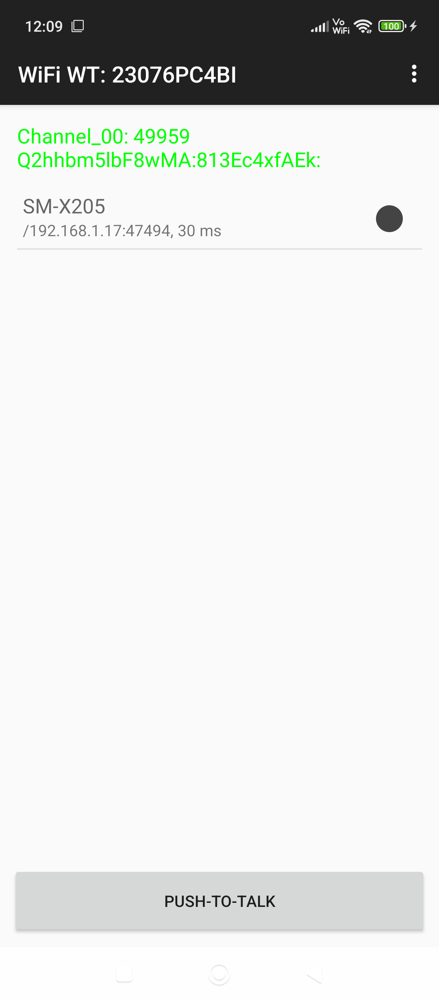

Walkie Talkie

A simple network-based walkie-talkie application that lets devices communicate with each other using live microphone audio.

Overview

This program transmits sound recorded from a device's microphone to other devices running the same application, allowing them to communicate like traditional walkie-talkie radios over a network.

Devices automatically discover each other using Network Service Discovery (NSD), also known as Bonjour, making it easier to connect without manually entering device addresses.

Screenshot

!Walkie Talkie application screenshot

Features
Live audio transmission — Stream microphone audio to other devices running the application.
Automatic device discovery — Discover other devices using NSD (Bonjour).
Network communication — Transfer audio data between devices over the network.
Walkie-talkie functionality — Communicate with compatible devices running the same program.
Technologies Used
NSD / Bonjour — For automatic discovery of devices on the network.
JS-Collider — A scalable Java NIO framework used for network data transfer.

For more information about JS-Collider, refer to its Git repository.
JS-Collider
===========

                     JS-Collider
                     ===========
    
                       +-----+
                 /-----|     |-----\        +---+ 
                /      |     |      <=======|A/C| Session emitters
               /   /---|     |---\   \      +---+ (acceptor/connector)
              /   /    +-----+    \   \
              |   |     <----     |   |
    TCP/IP ---+-S |               |   |
    session  +-----+             +-----+
             |     |             |     |
             |     |             |     |
             |     |             |     |
             +-----+             +-----+
              |   |               |   |
              |   |     ---->     |   |
              \   \    +-----+    /   /
               \   \---|     |---/   /
                \      |     |  S   /
                 \-----|     |--+--/
                       +-----+  |
                                |
                              TCP/IP
                              session

License

This project is released under the GNU Affero General Public License (AGPL).

See the LICENSE file in the repository for the full license text.

Getting Started
Clone or download the repository.
Build and run the application according to the project's setup instructions.
Run the application on multiple devices connected to a network that supports device discovery.
Use the application to transmit microphone audio between devices.